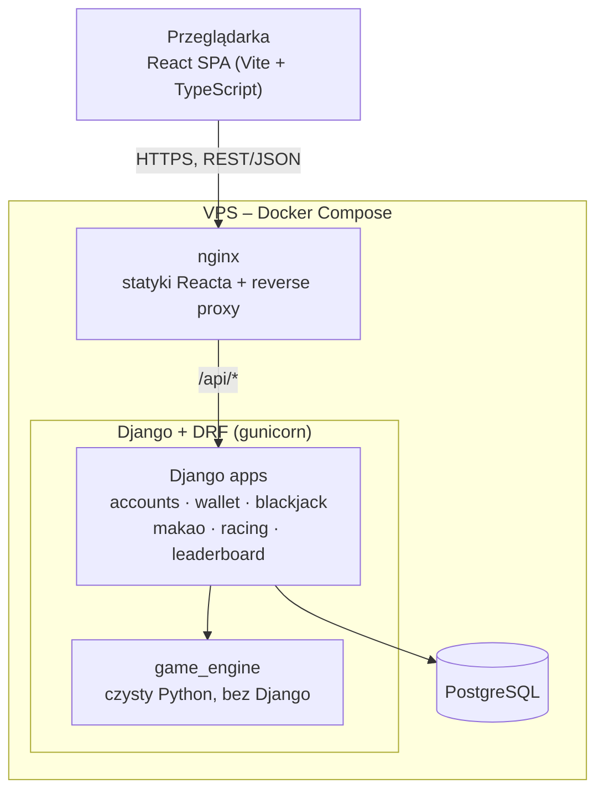
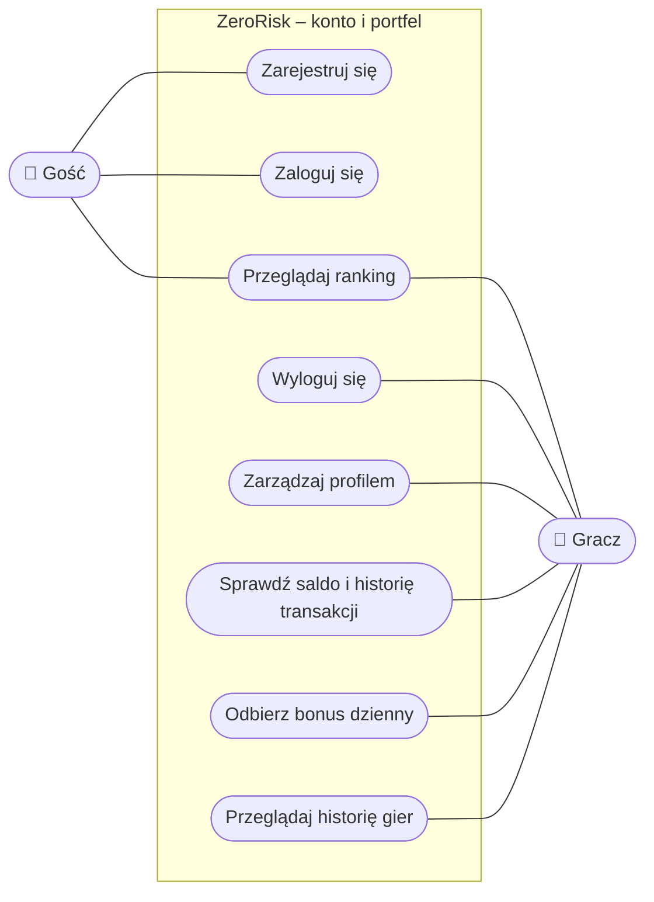
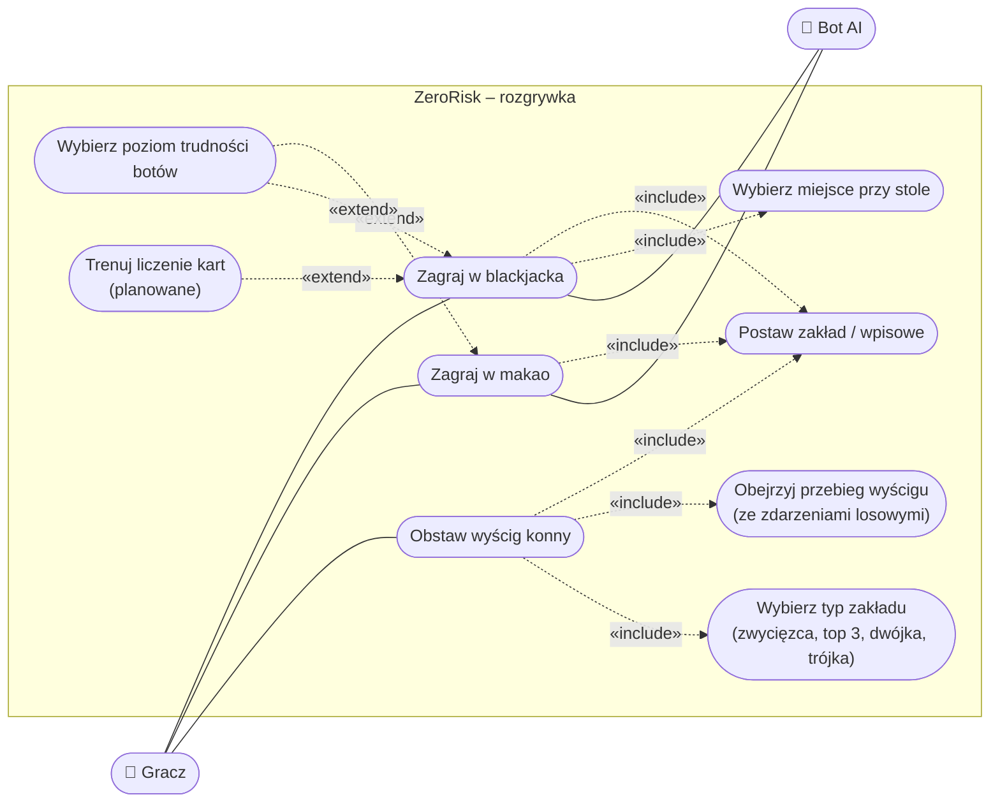
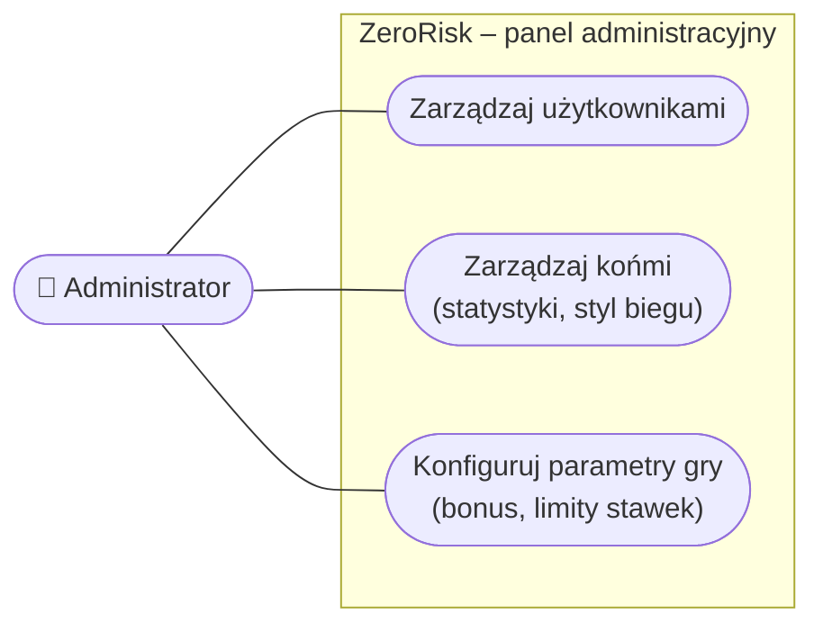
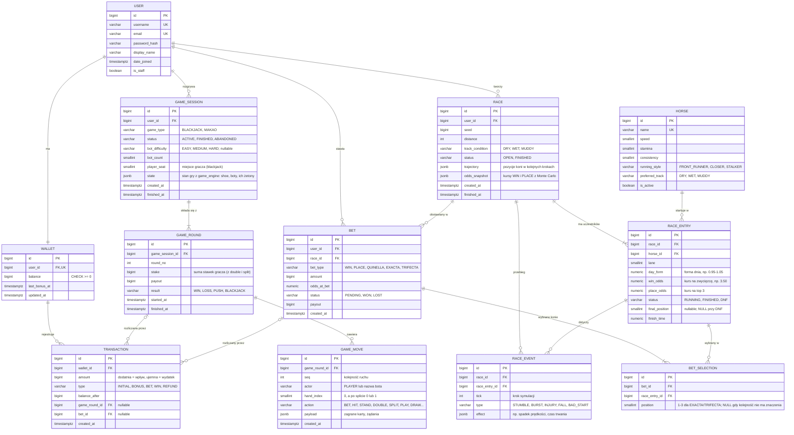
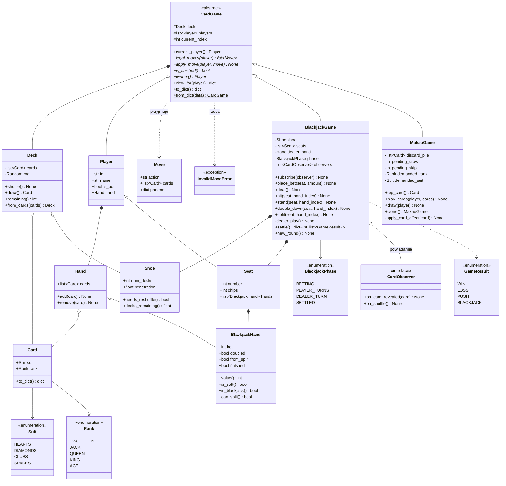
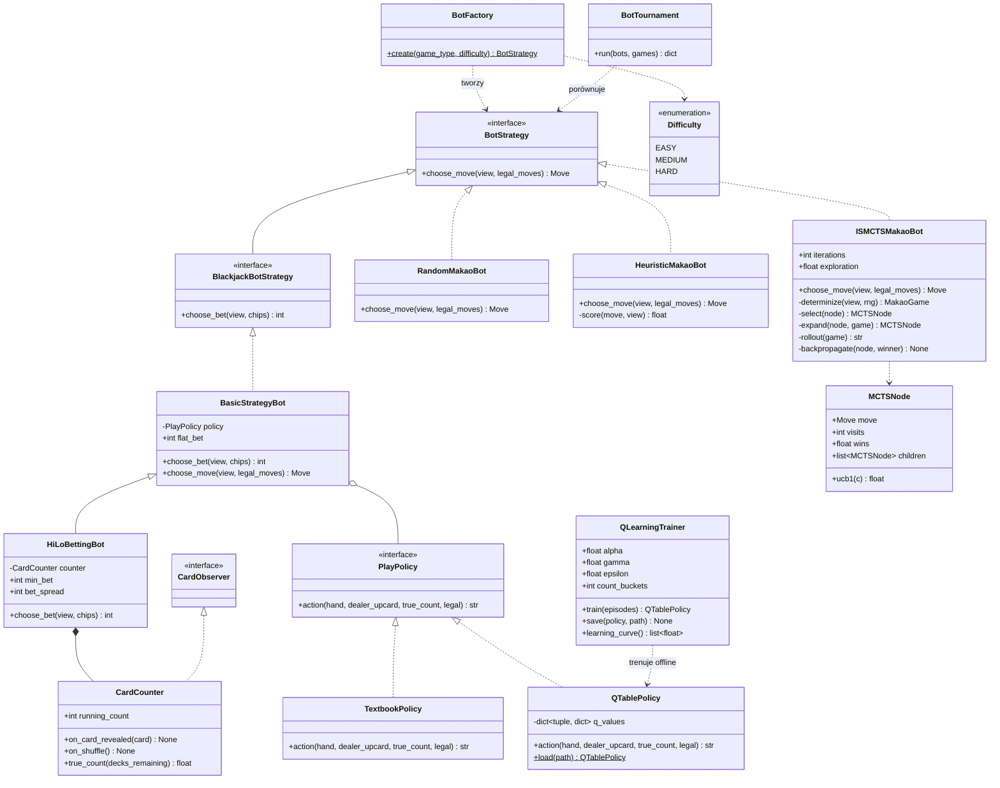
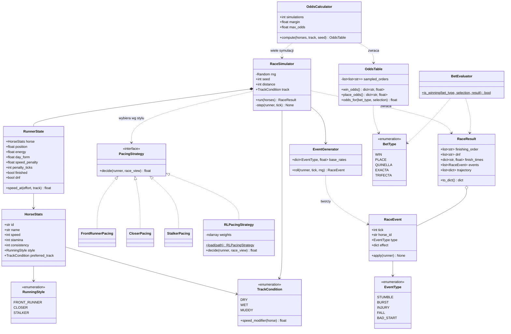
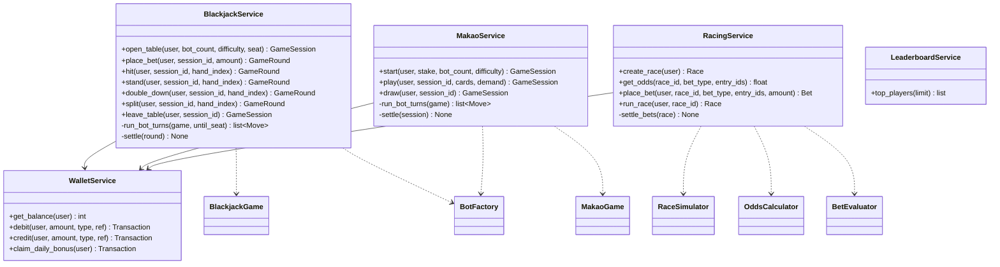

# ZeroRisk – architektura

Dokument opisuje architekturę projektu ZeroRisk: przegląd systemu, przypadki użycia, model danych (ERD) i diagramy klas.
Diagramy są w Mermaid – GitHub renderuje je bezpośrednio w podglądzie pliku.

## Założenia do potwierdzenia przez zespół

- Wyścigi są **na żądanie**: gracz tworzy wyścig, widzi konie i kursy, obstawia, a serwer od razu liczy wynik (z seeda). Frontend tylko animuje gotowy przebieg.
- Waluta to całe **żetony** (liczby całkowite, bez groszy). Nowy gracz dostaje startową pulę, potem bonus dzienny.
- **Makao**: gracz kontra 1–3 boty z wybranym poziomem trudności. Wpisowe trafia do puli, wygrany zabiera pulę.
- Ranking jest liczony z danych (saldo / wygrane), bez osobnej tabeli.

## Ustalenia – wyścigi konne

- Konie są **symulowane algorytmicznie** (statystyki + styl biegu + forma dnia + warunki toru + losowość z seeda), nie przez wytrenowany model.
- Taktyka konia jest wydzielona za interfejsem `PacingStrategy`. Opcjonalnie (jeśli starczy czasu) dochodzi `RLPacingStrategy` – „dżokej” wytrenowany offline metodą RL na naszym symulatorze.
- W trakcie wyścigu występują **zdarzenia losowe**: potknięcie, zryw, kontuzja, upadek, zły start. Losowane z seeda wyścigu, więc są odtwarzalne.
- Kontuzja działa **tylko do końca wyścigu** – konie nie mają stanu przenoszonego między wyścigami.
- Kursy liczone metodą **Monte Carlo** (wiele symulacji z różnymi seedami), więc automatycznie uwzględniają zdarzenia losowe.
- Typy zakładów: **zwycięzca, miejsce (top 3), dwójka w dowolnej kolejności, dokładna dwójka, dokładna trójka**.
- Koń, który nie ukończył wyścigu (DNF), przegrywa wszystkie zakłady, w których występuje.

## Ustalenia – blackjack

- Przy stole siedzi **gracz + 1–4 boty** (5 miejsc), wszyscy grają przeciwko krupierowi. Gracz wybiera miejsce przy otwarciu stołu; ruchy wykonuje się w kolejności miejsc.
- Sesja blackjacka to **stół z wieloma rundami**. Karty idą z **shoe** (6 talii), który przechodzi między rundami i jest tasowany po przekroczeniu karty cięcia (~75% shoe) – bez tego liczenie kart nie miałoby sensu.
- Zasady: hit, stand, double, **split** (jedno rozdzielenie, bez ponownego splitu; rozdzielone asy dostają po jednej karcie). Bez insurance i surrender. Krupier staje na miękkim 17, blackjack płaci 3:2.
- Boty **liczą karty systemem Hi-Lo**. Poziomy:
  - EASY – podstawowa strategia, stała stawka, bez liczenia,
  - MEDIUM – podstawowa strategia + stawka zależna od true count,
  - HARD – stawka jak MEDIUM, a decyzje z **tabeli wyuczonej przez Q-learning** (uwzględnia true count, więc sama „odkrywa” odstępstwa od strategii).
- Boty są **tymczasowe** – powstają przy otwarciu stołu, ich żetony żyją tylko w stanie gry (JSONB). Bot bez żetonów odchodzi od stołu.
- Gracz widzi liczenie **tylko po zachowaniu botów** (rosnące stawki). Licznik (`CardCounter`) jest osobną klasą, żeby później dodać **tryb treningu liczenia kart** bez zmian w silniku.

## Ustalenia – AI botów

- Bez płatnych API i bez LLM. Wszystko liczy się lokalnie w `game_engine`, na zwykłym CPU.
- **Blackjack – Q-learning (uczenie ze wzmocnieniem).** Agent trenuje offline (skrypt, kilka milionów rozdań w `BlackjackGame`) i zapisuje tabelę Q do JSON. W runtime bot tylko ją odczytuje. Na prezentację: heatmapa strategii wyuczonej przez AI obok podręcznikowej podstawowej strategii + krzywa uczenia.
- **Makao – ISMCTS (Information Set Monte Carlo Tree Search).** Bez treningu i danych: przed ruchem bot losuje możliwe karty przeciwników zgodnie z tym, co widział, rozgrywa wiele symulacji i wybiera najlepszy ruch. Poziom trudności = liczba iteracji. Na prezentację: turniej botów (Random vs Heurystyka vs ISMCTS) z tabelą win-rate.
- Opcjonalnie: komentarze botów przy stole z puli szablonów tekstowych (bez AI).
- Szacowany nakład: Q-learning ~15 h, ISMCTS ~20–25 h, turniej i wykresy ~5 h.

---

## 1. Przegląd systemu

Zasada: `game_engine` nie importuje niczego z Django. Django apps odpowiadają za użytkownika, portfel, bazę i API; `game_engine` – tylko za reguły gier, boty i symulację.

---

## 2. Diagram przypadków użycia

Mermaid nie ma natywnego diagramu przypadków użycia, więc są one narysowane jako flowchart: aktorzy na zewnątrz, przypadki użycia w zaokrąglonych węzłach wewnątrz granicy systemu. Dla czytelności podzielone są na trzy obszary.

### 2.1. Konto i portfel

### 2.2. Rozgrywka

### 2.3. Administracja

| Aktor | Opis |
| --- | --- |
| Gość | Niezalogowany użytkownik. Może się zarejestrować, zalogować i zobaczyć ranking. |
| Gracz | Zalogowany użytkownik. Gra, obstawia, zarządza swoim kontem. |
| Bot AI | Aktor drugorzędny (systemowy): krupier w blackjacku, przeciwnicy w makao. |
| Administrator | Zarządza danymi przez panel Django Admin. |

---

## 3. Diagram encji (ERD)

Encje odpowiadają modelom Django w PostgreSQL. Kwoty to `bigint` (żetony). `jsonb` przechowuje stan gry i przebieg wyścigu.

Najważniejsze reguły integralności:

- `WALLET.balance` ma `CHECK (balance >= 0)`; każda zmiana salda idzie przez `WalletService` w `transaction.atomic()` z `select_for_update()` i tworzy rekord `TRANSACTION`.
- `RACE_ENTRY` ma `UNIQUE (race_id, horse_id)` oraz `UNIQUE (race_id, lane)`.
- `GAME_ROUND` ma `UNIQUE (game_session_id, round_no)`. Makao ma zawsze jedną rundę na sesję, blackjack – wiele.
- `GAME_MOVE` ma `UNIQUE (game_round_id, seq)`. Ruchy botów też są zapisywane – przydadzą się do historii i trybu treningu.
- `BET` można postawić tylko na wyścig w statusie `OPEN`.
- `BET_SELECTION` ma `UNIQUE (bet_id, race_entry_id)`. Liczba wyborów zależy od typu zakładu: WIN/PLACE – 1, QUINELLA/EXACTA – 2, TRIFECTA – 3 (walidacja w `RacingService`).
- `RACE_EVENT` to źródło prawdy o zdarzeniach (statystyki typu „ile razy koń upadł”); `RACE.trajectory` służy tylko do animacji.

Typy zakładów:

| Typ | Nazwa | Wygrywa, gdy |
| --- | --- | --- |
| `WIN` | Zwycięzca | wybrany koń jest 1. |
| `PLACE` | Miejsce | wybrany koń jest w top 3 |
| `QUINELLA` | Dwójka | dwa wybrane konie zajmują miejsca 1–2 w dowolnej kolejności |
| `EXACTA` | Dokładna dwójka | dwa wybrane konie zajmują miejsca 1 i 2 w podanej kolejności |
| `TRIFECTA` | Dokładna trójka | trzy wybrane konie zajmują miejsca 1, 2, 3 w podanej kolejności |

---

## 4. Diagramy klas

### 4.1. `game_engine` – karty i gry karciane

`BlackjackGame` powiadamia obserwatorów (`CardObserver`, wzorzec Observer) o każdej **odkrytej** karcie i o przetasowaniu shoe. Zakryta karta krupiera jest zgłaszana dopiero po jej odkryciu – boty liczą tylko to, co widziałby człowiek przy stole.

### 4.2. `game_engine` – boty (wzorzec Strategy)

Poziomy botów:

| Poziom | Blackjack | Makao |
| --- | --- | --- |
| EASY | `BasicStrategyBot` + `TextbookPolicy`, stała stawka | `RandomMakaoBot` |
| MEDIUM | `HiLoBettingBot` + `TextbookPolicy` – liczy Hi-Lo, stawka rośnie z true count | `HeuristicMakaoBot` |
| HARD | `HiLoBettingBot` + `QTablePolicy` – stawka z liczenia, decyzje wyuczone przez Q-learning | `ISMCTSMakaoBot` |

**Q-learning (blackjack).** Stan = (suma kart, miękki as, odkryta karta krupiera, przedział true count), akcje = HIT / STAND / DOUBLE / SPLIT, nagroda = wynik rozdania w stawkach. To kilka tysięcy stanów, więc wystarcza zwykła tabela – bez sieci neuronowej i GPU. `QLearningTrainer` jest uruchamiany ręcznie (komenda / skrypt), a wynik (`q_table.json`) commitujemy do repo; serwer tylko go wczytuje.

**ISMCTS (makao).** Bot widzi tylko swoją rękę, więc w każdej iteracji losuje („determinizuje”) karty przeciwników spośród kart, które mogą u nich być, i rozgrywa partię na kopii gry (`MakaoGame.clone()`). Ruch wybierany jest wg UCB1 w drzewie wspólnym dla wszystkich determinizacji. Czas ruchu kontrolujemy liczbą iteracji (np. 200 / 1000 / 3000).

**`BotTournament`** rozgrywa serię partii bot vs bot i zwraca statystyki (win-rate, średni wynik) – do testów i na prezentację.

Krupier nie jest botem – jego zachowanie wynika z zasad (`BlackjackGame.dealer_play()`).
`CardCounter` nie zna gry ani botów, więc w trybie treningu liczenia posłuży jako „wzorzec” do sprawdzania odpowiedzi gracza.
Bot dostaje tylko `view_for(bot)`, czyli to, co widziałby gracz na jego miejscu (bez kart przeciwników).

### 4.3. `game_engine` – wyścigi konne

Symulacja jest algorytmiczna. Taktyka konia (`PacingStrategy`) i zdarzenia losowe (`EventGenerator`) są wydzielone, żeby dało się je osobno testować i podmieniać.

Uwagi do implementacji:

- **Odtwarzalność:** ten sam `seed`, konie i warunki toru zawsze dają ten sam wynik, łącznie ze zdarzeniami losowymi.
- **Zdarzenia:** szansa zdarzenia zależy od stanu konia (np. niska `energy` zwiększa szansę potknięcia, wysoka `consistency` ją zmniejsza). Orientacyjne częstości na konia na wyścig: potknięcie ~10%, zryw ~10%, zły start ~5%, kontuzja ~3%, upadek ~1%. `FALL` ustawia `dnf = True`, `INJURY` obniża prędkość do końca biegu.
- **Kursy:** `OddsCalculator` puszcza np. 5000 symulacji z seedami pochodnymi od seeda wyścigu i liczy częstość każdego wyniku. Kurs = 1 / prawdopodobieństwo × (1 − marża), ograniczony do `max_odds` (kombinacja, która nie wypadła w żadnej symulacji, dostaje maksymalny kurs). Kursy WIN/PLACE zapisujemy w `RACE.odds_snapshot`, kursy kombinacji liczymy przy stawianiu zakładu i zapisujemy w `BET.odds_at_bet`.
- **`RLPacingStrategy` jest opcjonalna** – trenowana offline na `RaceSimulator`, w runtime tylko inferencja (numpy).

### 4.4. Warstwa Django – serwisy

Serwisy łączą `game_engine` z bazą i portfelem. Widoki DRF tylko walidują żądanie i wołają serwis.

